# Slov — Data model (ERD)

Local school ERP for Rewa. Staff use web, iOS and Android. Parents use the mobile app only.

## Locked rules

1. **Time is stored in UTC.** Every moment-in-time column is `timestamptz` (suffix `_at`). The API sends ISO 8601 UTC (`2026-11-01T04:30:00Z`).
2. **Time is shown in IST** (`Asia/Kolkata`, UTC+5:30, no daylight saving). Clients convert at the edge. Never format in the browser's local zone.
3. **Calendar dates are plain `date` in school-local (IST) time** (suffix `_on`): date of birth, attendance day, holiday, fee due date. They are not instants, so they have no zone.
4. **Money is stored as integer paise** (`bigint`). ₹1,500.00 is `150000`.
5. Primary keys are UUID v7. Every table has `created_at`, `updated_at`. Business records use soft delete (`deleted_at`).
6. All writes that change money, attendance, results or permissions are written to `audit_logs`.

## Diagram

```mermaid
erDiagram
  users ||--o| staff_profiles : "is"
  users ||--o{ staff_permissions : "granted"
  users ||--o{ guardians : "parent login"
  users ||--o{ device_tokens : "push"
  staff_profiles ||--o{ class_staff : "assigned"
  staff_profiles ||--o{ staff_attendance : "marked"

  academic_years ||--o{ classes : "has"
  classes ||--o{ class_staff : "teachers"
  classes ||--o{ enrollments : "students"
  students ||--o{ enrollments : "per year"
  students ||--o{ student_guardians : "has"
  guardians ||--o{ student_guardians : "of"

  enrollments ||--o{ attendance_records : "daily"
  classes ||--o{ attendance_days : "day marked"
  attendance_days ||--o{ attendance_records : "contains"

  exams ||--o{ exam_subjects : "papers"
  subjects ||--o{ exam_subjects : "for"
  classes ||--o{ exam_subjects : "class"
  enrollments ||--o{ results : "gets"
  exam_subjects ||--o{ results : "marks"

  admissions }o--o| students : "becomes"
  import_jobs ||--o{ import_rows : "rows"

  fee_heads ||--o{ fee_structures : "priced"
  classes ||--o{ fee_structures : "per class"
  enrollments ||--o{ fee_invoices : "billed"
  fee_invoices ||--o{ fee_invoice_items : "lines"
  fee_invoices ||--o{ fee_payments : "paid by"
  fee_heads ||--o{ fee_invoice_items : "of"

  library_books ||--o{ library_copies : "copies"
  library_copies ||--o{ library_loans : "lent"

  threads ||--o{ thread_members : "members"
  students ||--o{ threads : "about"
  threads ||--o{ messages : "messages"
  messages }o--o| attachments : "material"
  classes ||--o{ threads : "class group"

  notices }o--o| classes : "audience"

  students ||--o{ student_events : "history"
  feedback_requests ||--o{ feedback_targets : "teachers rated"
  feedback_targets ||--o{ feedback_responses : "answers"
  staff_profiles ||--o{ feedback_targets : "about"
  promotion_batches ||--o{ promotion_items : "decisions"
  enrollments ||--o{ promotion_items : "for"
  exams ||--o{ exam_publications : "released"
  classes ||--o{ exam_publications : "per class"
  classes ||--o{ broadcasts : "to"
  subjects ||--o{ broadcasts : "about"
  users ||--o| credential_invites : "invite"
  schools ||--o{ users : "members"
  schools ||--|| school_subscriptions : "plan"
  schools ||--o{ school_usage_daily : "headcount"
  schools ||--o{ platform_invoices : "billed"
  users ||--o{ auth_sessions : "devices"
  users ||--o{ notifications : "receives"
  exam_schedules ||--o{ exam_papers : "dates"

  users {
    uuid id PK
    text name
    text phone UK
    text email UK "login id"
    text password_hash
    bool must_change_password
    timestamptz password_changed_at
    uuid school_id FK "null only for owner"
    text kind "owner | staff | parent"
    bool is_admin "school admin, bypasses all school permissions"
    bool is_active
    timestamptz last_login_at
  }
  staff_profiles {
    uuid user_id PK, FK
    text employee_code UK
    text designation
    text department
    date joined_on
    text qualification
    text photo_url
  }
  staff_permissions {
    uuid user_id FK
    text permission "fees.manage | library.manage | staff.manage | academic.manage"
  }
  staff_attendance {
    uuid id PK
    uuid staff_id FK
    date day_on
    text status "present | absent | leave"
    text reason
    uuid marked_by FK
    timestamptz marked_at
  }
  academic_years {
    uuid id PK
    text name "2026-27"
    date starts_on
    date ends_on
    bool is_current
  }
  classes {
    uuid id PK
    uuid academic_year_id FK
    text grade "Nursery, 1 .. 12"
    text section "A, B"
    int capacity
  }
  class_staff {
    uuid id PK
    uuid class_id FK
    uuid staff_id FK
    text role "class_teacher | subject_teacher"
    uuid subject_id FK
  }
  students {
    uuid id PK
    text scholar_no UK
    text first_name
    text last_name
    date dob
    text gender
    text address
    text status "active | left | tc_issued | passed_out"
    date admitted_on
    date left_on
    text leaving_reason
    text tc_number UK
    text photo_url
  }
  guardians {
    uuid id PK
    uuid user_id FK "set once parent app login is created"
    text name
    text phone
    text email
  }
  student_guardians {
    uuid student_id FK
    uuid guardian_id FK
    text relation "father | mother | other"
    bool is_primary
  }
  enrollments {
    uuid id PK
    uuid student_id FK
    uuid class_id FK
    uuid academic_year_id FK "unique with student_id"
    int roll_no
    text status "active | promoted | detained | left"
    date started_on
    date ended_on
  }
  admissions {
    uuid id PK
    text applicant_name
    date dob
    text grade_applied
    text guardian_name
    text guardian_phone
    text status "enquiry | applied | approved | rejected | enrolled"
    uuid student_id FK
    timestamptz applied_at
    uuid handled_by FK
  }
  import_jobs {
    uuid id PK
    text kind "students"
    text file_name
    text status "uploaded | validated | imported | failed"
    int total_rows
    int ok_rows
    int error_rows
    uuid created_by FK
  }
  import_rows {
    uuid id PK
    uuid job_id FK
    int row_no
    jsonb data
    text error
  }
  attendance_days {
    uuid id PK
    uuid class_id FK
    date day_on
    uuid marked_by FK "class teacher only"
    timestamptz marked_at
  }
  attendance_records {
    uuid id PK
    uuid attendance_day_id FK
    uuid enrollment_id FK
    text first_half "present | absent | leave"
    text second_half "present | absent | leave"
    bool late
    text note
  }
  subjects {
    uuid id PK
    text name
    text code
  }
  exams {
    uuid id PK
    uuid academic_year_id FK
    text name "Half-yearly"
    date starts_on
    date ends_on
    timestamptz published_at
  }
  exam_subjects {
    uuid id PK
    uuid exam_id FK
    uuid class_id FK
    uuid subject_id FK
    int max_marks
  }
  results {
    uuid id PK
    uuid exam_subject_id FK
    uuid enrollment_id FK
    numeric marks_obtained
    text grade
    text remarks
    uuid entered_by FK "class teacher only"
    timestamptz entered_at
  }
  fee_heads {
    uuid id PK
    text name "Tuition, Transport, Lab"
  }
  fee_structures {
    uuid id PK
    uuid class_id FK
    uuid fee_head_id FK
    bigint amount_paise
    text frequency "monthly | quarterly | yearly | once"
  }
  fee_invoices {
    uuid id PK
    uuid enrollment_id FK
    text invoice_no UK
    text period_label "Term 2"
    date due_on
    bigint total_paise
    bigint discount_paise
    text status "unpaid | partial | paid | waived"
  }
  fee_invoice_items {
    uuid id PK
    uuid invoice_id FK
    uuid fee_head_id FK
    bigint amount_paise
  }
  fee_payments {
    uuid id PK
    uuid invoice_id FK
    bigint amount_paise
    text mode "cash | cheque | upi | bank_transfer"
    text reference
    text receipt_no UK
    timestamptz received_at
    uuid received_by FK
  }
  library_books {
    uuid id PK
    text title
    text author
    text isbn
    text category
  }
  library_copies {
    uuid id PK
    uuid book_id FK
    text accession_no UK
    text status "available | issued | lost"
  }
  library_loans {
    uuid id PK
    uuid copy_id FK
    uuid student_id FK
    uuid staff_id FK
    timestamptz issued_at
    date due_on
    timestamptz returned_at
    bigint fine_paise
    uuid issued_by FK
  }
  holidays {
    uuid id PK
    text title
    date from_on
    date to_on
    text kind "holiday | exam | event"
    uuid created_by FK
  }
  notices {
    uuid id PK
    text title
    text body
    text audience "all | staff | parents | class"
    uuid class_id FK
    timestamptz published_at
    timestamptz expires_at
    uuid created_by FK
  }
  threads {
    uuid id PK
    text kind "direct"
    uuid student_id FK "which child this is about"
    uuid class_id FK
    text title
  }
  thread_members {
    uuid thread_id FK
    uuid user_id FK
    timestamptz last_read_at
  }
  messages {
    uuid id PK
    uuid thread_id FK
    uuid sender_id FK
    text body
    uuid attachment_id FK
    timestamptz sent_at
  }
  attachments {
    uuid id PK
    text url
    text mime
    bigint size_bytes
    uuid uploaded_by FK
  }
  device_tokens {
    uuid id PK
    uuid user_id FK
    text platform "ios | android"
    text token UK
  }
  student_events {
    uuid id PK
    uuid student_id FK
    text kind "admitted | promoted | detained | class_changed | left | tc_issued | rejoined | passed_out"
    uuid from_class_id FK
    uuid to_class_id FK
    uuid academic_year_id FK
    date effective_on
    text reason
    uuid recorded_by FK
    timestamptz recorded_at
  }
  promotion_batches {
    uuid id PK
    uuid from_year_id FK
    uuid to_year_id FK
    text status "draft | applied"
    uuid created_by FK
    timestamptz applied_at
  }
  promotion_items {
    uuid id PK
    uuid batch_id FK
    uuid enrollment_id FK
    text decision "promote | detain | leave | pass_out"
    uuid to_class_id FK
  }
  exam_publications {
    uuid id PK
    uuid exam_id FK
    uuid class_id FK
    timestamptz published_at
    uuid published_by FK
  }
  report_remarks {
    uuid id PK
    uuid exam_id FK
    uuid enrollment_id FK
    text remark
  }
  broadcasts {
    uuid id PK
    uuid class_id FK
    uuid subject_id FK "null = general"
    uuid sender_id FK
    text body
    uuid attachment_id FK
    timestamptz sent_at
  }
  credential_invites {
    uuid id PK
    uuid user_id FK
    text status "pending | sent | failed"
    int send_count
    timestamptz last_sent_at
    uuid last_sent_by FK
    text last_error
  }
  auth_sessions {
    uuid id PK
    uuid user_id FK
    text device
    text refresh_hash
    timestamptz expires_at
    timestamptz revoked_at
  }
  feedback_requests {
    uuid id PK
    uuid school_id FK
    text title
    date opens_on
    date closes_on
    text status "draft | open | closed"
    bool share_with_teachers "teachers see their own summary"
    uuid created_by FK
  }
  feedback_targets {
    uuid id PK
    uuid request_id FK
    uuid staff_id FK
    uuid class_id FK
    uuid subject_id FK
  }
  feedback_responses {
    uuid id PK
    uuid target_id FK
    uuid guardian_id FK "only to stop duplicates, never returned by the API"
    uuid student_id FK
    int rating "1 to 5"
    text comment "optional, max 500"
    timestamptz submitted_at
  }
  schools {
    uuid id PK
    text name
    text slug UK
    text city
    text status "trial | active | suspended"
    timestamptz created_at
    uuid created_by FK "owner user"
  }
  school_subscriptions {
    uuid id PK
    uuid school_id FK
    bigint price_per_student_paise "default 1000 = Rs 10"
    date started_on
    text status "trial | active | cancelled"
  }
  school_usage_daily {
    uuid school_id FK
    date day_on
    int active_students
  }
  platform_invoices {
    uuid id PK
    uuid school_id FK
    date period_on "first day of the billed month"
    int active_students
    bigint price_per_student_paise
    bigint amount_paise
    date due_on
    text status "due | paid | waived"
    timestamptz paid_at
    text payment_mode
    text reference
    uuid recorded_by FK
  }
  notifications {
    uuid id PK
    uuid school_id FK
    uuid user_id FK "recipient parent or staff"
    uuid student_id FK
    text type "attendance_present | attendance_absent | attendance_first_half | attendance_second_half | fee_reminder | notice | exam | result | feedback"
    jsonb params "amount, due date, title"
    timestamptz created_at
    timestamptz read_at
    timestamptz push_sent_at
  }
  notification_preferences {
    uuid user_id FK
    text type
    bool enabled
  }
  exam_schedules {
    uuid id PK
    uuid school_id FK
    text name "Half-yearly exams"
    timestamptz published_at
    uuid created_by FK
  }
  exam_papers {
    uuid id PK
    uuid schedule_id FK
    uuid class_id FK
    uuid subject_id FK
    date paper_on "IST date"
    time starts_at "IST clock time"
  }
  audit_logs {
    uuid id PK
    uuid actor_id FK
    text action
    text entity
    uuid entity_id
    jsonb before
    jsonb after
    timestamptz at
  }
```

## Who can do what

`users.is_admin = true` bypasses every check below.

| Capability | Rule |
|---|---|
| Manage fees (invoices, record offline payment, receipts) | `fees.manage` |
| Library books, issue and return | `library.manage` |
| Staff directory, class assignment, mark teacher absent, grant permissions | `staff.manage` |
| Holidays, calendar dates, notices, exams, subjects | `academic.manage` |
| Admissions, student records, Excel import | `academic.manage` |
| Mark attendance | the **class teacher** of that class (`class_staff.role = class_teacher`) |
| Enter results | the **class teacher** of that class |
| Message a class group or one parent, share material | any teacher **assigned to that class** (`class_staff`) |
| See own child's attendance, results, fees, notices, messages | parent, through `student_guardians` |

Permissions are fixed keys, not free-form roles. A staff member can hold any combination plus any class assignments. Class assignment is data, not a permission.

## Parent side

Parents have a `users` row (`kind = parent`) linked from `guardians.user_id`. They can only read rows reached through `student_guardians`. They never see another child's data. Parent login is mobile app only.

## v2 rules

### Attendance (half days and stats)
- One `attendance_days` row per class per school day, created when the class teacher saves. One `attendance_records` row per enrolled student, with `first_half` and `second_half`.
- Value of a day: present+present = 1, present+absent (either order) = 0.5 (a "half day"), absent+absent = 0. `leave` counts as absent but is shown separately.
- Attendance % = sum of day values ÷ working days. Working days = days the class was marked, minus holidays (`holidays.kind = holiday`). Stats are **computed**, never stored.
- Students who have left (`students.status != active`) get no new records. Old records stay.

### Student lifecycle and history
- `students.status`: `active`, `left`, `tc_issued`, `passed_out`.
- Every change writes a `student_events` row (admitted, promoted, detained, class_changed, left, tc_issued, rejoined, passed_out) with date, reason and who did it. This is the full record history, shown as a timeline on the student profile.
- **Marking a student as left** (needs `academic.manage`): sets `status`, `left_on`, `leaving_reason`, closes the enrollment, writes an event. After that: no attendance rows, no new fee invoices, existing dues stay visible to fees staff, parent login becomes **read-only** (history, results, fees receipts stay readable, messaging stops).
- A student can be **rejoined**: status back to `active`, new enrollment, `rejoined` event.

### Year-end promotion
- A `promotion_batch` moves a whole year to the next. Staff open a draft: every active enrollment gets a default decision (`promote` to the next grade, same section; `pass_out` for the last grade), then override per student (`detain`, `leave`, other section).
- **Apply** is one transaction: close old enrollments (`promoted` or `detained`), create new enrollments in the new `academic_year`, update `students.status`, write `student_events`. A batch can be applied once. Fee invoices for the new year are generated separately.

### Results
- Class teacher enters marks (`results`) and a remark (`report_remarks`). Parents see nothing until the class teacher **publishes** (`exam_publications`). Unpublishing hides it again.

### Messaging
- **Broadcast** (`broadcasts`): a teacher assigned to a class sends to all parents of that class. A subject teacher can broadcast only for their own subject (`class_staff.subject_id`). The class teacher can send general or any subject. Parents read only, they cannot reply to a broadcast.
- **Personal** (`threads` kind `direct`, one per parent + teacher + child): a teacher assigned to the child's class can start one. A parent can reply, and can start one with the class teacher or a subject teacher of the child's class. Disabled when the student has left.

### Login (single login, routed by user type)
- Everyone signs in with **email + password**. The token carries `kind`. `staff` goes to the staff UI, `parent` goes to the parent UI. Parents can also sign in on the web and get a simple parent dashboard (same child switcher, attendance, results, messages, fees, notices).
- **Parent accounts from an email list.** Staff import or paste a list: `student scholar no, guardian name, email, mobile`. The system groups rows by email. One email = one `users` row + one `guardians` row linked to every child (`student_guardians`). The same email on two children means one login with a child switcher in the app.
- The system creates the account with `must_change_password = true`. **No password is stored in plain text.** Pressing **Send login email** (one click, or bulk for all pending) generates a fresh temporary password, hashes it, and emails the parent: email id, temporary password, app links. Resend always generates a new one. `credential_invites` records status, count, time (UTC), and who sent it.
- First login forces a new password. Sessions use short-lived access tokens + refresh tokens (`auth_sessions`), revocable per device.

## v3: multi-school and the product owner

Slov is one product serving many schools. The platform owner (us) runs it.

### Tenancy
- `schools` is the tenant. **Every school table carries `school_id`** (students, classes, staff profiles, fees, library, notices, and so on) and every query is filtered by the `school_id` in the access token. Uniqueness is per school, for example `unique (school_id, scholar_no)` and `unique (school_id, employee_code)`.
- `users.kind` is `owner`, `staff` or `parent`. `owner` has no `school_id`. A parent email belongs to one school.
- Postgres row-level security on `school_id` is the second line of defence behind the application filter.

### Owner (super admin)
- Signs in with the same email + password login and is routed to the owner portal.
- **Create school**: owner enters school name, city and the admin's name and email. The system creates the `school`, a `school_subscriptions` row (default price), the admin `users` row (`kind = staff`, `is_admin = true`, `must_change_password = true`) and a `credential_invites` row. **Send login email** works exactly as for parents.
- The school admin then manages everything inside the school: staff, permissions, classes, students.
- **Suspend**: blocks every login of that school (staff and parents) with a clear message. No data is deleted. **Reactivate** restores it.
- The owner sees **counts and money only**, never student, fee or message records of a school. Support access to school data would need an explicit, logged, time-limited grant (not built).

### Pricing and billing
- **Rs 10 per active student per month** (`price_per_student_paise = 1000`), editable per school for special cases.
- `school_usage_daily` stores each school's active student count every day (students with `status = active`). The monthly invoice uses the count on the **last day of the month**. Students who left do not count.
- `platform_invoices`: one per school per month, `amount = active_students x price`. Trial schools are not billed. Payments are recorded by the owner (`paid_at`, mode, reference). No online payment yet.
- **Stats are computed**, not stored: schools by status, active students, MRR (sum of active schools' students x price), ARR (MRR x 12), new schools per month, collected vs due.

## v4: analytics and feedback

### Analytics (no new tables)
Everything is computed from existing records, so there is nothing to keep in sync.
- **Attendance**: per day and class from `attendance_records` (half day = 0.5), trend over days, by class, by weekday, per-student heatmap, students under 75%.
- **Results**: per exam, subject averages, grade spread, class comparison, pass rate (from published `results`).
- **Teachers**: for each teacher, the average result of their subject across the classes they teach (`class_staff.subject_id`), their own attendance (`staff_attendance`), and their feedback rating when shared.
- Scope: admin and academic managers see the whole school. Any other teacher sees only classes they are assigned to. Teacher-wise numbers are visible to admin, `academic.manage` and `staff.manage`, and each teacher sees only their own row.
- Attendance is marked once a day per class (two halves), so there is no per-subject attendance. "Subject-wise" means results by subject.

### Feedback on teachers
- A user with `academic.manage` (or admin) creates a **feedback request**: title, which classes, closing date. The system creates one `feedback_targets` row for every teacher assigned to those classes (one per teacher, class and subject).
- Parents of those classes see the request in the app until it closes. For each teacher of their child they give **1 to 5 stars** and an **optional comment** (max 500 characters). One answer per parent per child per teacher.
- **Anonymous.** `guardian_id` exists only to block duplicates. No API returns it. Managers see averages, the 1 to 5 spread, response rate and comments without names.
- **Teachers** see their own summary only if the request has `share_with_teachers = true`. Comments are shown without names.
- A request closes automatically on `closes_on` (IST date) and can be closed early. Answers cannot be edited after the request closes.

## v5: notifications, receipts, exports, staff onboarding

### Notifications
- A row in `notifications` per recipient, plus a push to their devices (`device_tokens`) unless their `notification_preferences` turn that type off. The in-app list always shows it.
- **Attendance**: saving a class's attendance creates one notification per parent: present, absent, or which half the child attended. Texts: "{Name} is present today", "{Name} is absent today", "{Name} attended the first half only", "{Name} attended the second half only". A re-save the same day replaces earlier ones instead of sending twice.
- **Fee reminders**: users with `fees.manage` (or admin) can remind **all** parents whose child has a balance, or one parent. Text: "Fee reminder: ₹X is due for {Name} by {date}". A child is reminded at most once per 3 days.
- Also: notice published, exam date sheet published, result published, feedback requested.
- A child who has left school generates no attendance or fee notifications.

### Receipts
- Offline payments are recorded in `fee_payments` with a receipt number, time (UTC) and who received it. The receipt PDF (A5) is **rendered on demand** from that row and never stored. Staff can print or download it, and parents can download it from the app or web. Receipt numbers are per school and never reused.

### Excel export
- Every list a manager can see has an Excel export: students, fees, attendance statistics, staff, parent logins, library, admissions, results, analytics, and for the owner schools and revenue. The export is filtered exactly like the list on screen and needs the same permission. Money is in rupees as numbers, times are IST text. Exports are written to `audit_logs`.

### Staff onboarding
- Admin adds staff one by one or from a pasted list (name, designation, email). Each gets a `users` row and `credential_invites` like parents. **Send login** and **Send to all pending** create fresh temporary passwords. Everyone can **change password** from their account menu, and **Forgot password** emails a 30-minute reset link (same response whether or not the email exists).

### Exam date sheet
- Users with `academic.manage` publish an exam date sheet: for chosen classes, a date and start time per subject. Parents of those classes see it and get a notification.

## v6: fees setup, academic setup, leave, timetable, student record

### Fees: structure, invoices, concessions, payments
- `fee_heads` (tuition, transport, lab, admission) and `fee_structures` give the amount per class, head and academic year, with a frequency (monthly, quarterly, term, yearly, once).
- **Generating invoices** is one action: pick the year, period label ("Term 2") and due date. It creates one `fee_invoices` row per active student with one `fee_invoice_items` row per head in that class's structure. The run is recorded in `fee_invoice_runs` (who, when, how many) and cannot create a second invoice for the same student and period.
- **Concessions** (`fee_concessions`: sibling discount, RTE, staff child, merit; percent or fixed amount, optionally for one head) are attached to a student for a year through `student_concessions`, with a note and who approved it. They become negative lines on the invoice.
- **Late fee** (`fee_late_rules`: grace days, fixed amount or per day, maximum) is added by the system as a line after the due date, and can be waived by someone with `fees.manage` with a reason.
- **Carry forward**: unpaid balance of the previous period is added as a "Previous dues" line on the next invoice and the old invoice is marked closed.
- **Invoice total** = items + late fee + carried forward - discounts. Paid = sum of non-cancelled payments. Status is computed: unpaid, partial, paid.
- **Payments** are instalments on an invoice. Wrong entry? **Cancel it**: the payment stays in the table with `status = cancelled`, who cancelled it, when (UTC) and a required reason. Nothing is deleted, receipt numbers are never reused, and the cancellation is in `audit_logs`. Parents see "Cancelled by school" on that receipt.

### Academic setup
- Admin or `academic.manage` creates the **academic year**, **classes and sections**, **subjects** (`subjects`, with `class_subjects` for what each class studies), the **grading scheme** (`grading_schemes` and `grade_bands`: minimum percent to grade, for example 90 = A+), and **exams** with their subjects, maximum and pass marks (`exam_subjects`).
- **Report card**: generated on demand per student and exam from published results, the grading scheme, the class teacher's remark and attendance for the period. Staff download an A4 PDF. Parents can download it once the class teacher has published the results. `report_cards` records each publish for audit. PDFs are never stored.

### Leave applications
- A parent applies from the app for one child: from date, to date, optional half day (first or second half, single day only), reason. Status `pending`, `approved`, `rejected` or `cancelled` (the parent can cancel while pending).
- The **class teacher** of that child's class (or admin) approves or rejects with an optional note. The parent is notified.
- Approved leave **pre-selects "Leave"** on the attendance screen for those days. The class teacher still saves attendance as usual. Leave counts as not present in attendance statistics but is shown separately.
- Table: `leave_requests` (student, guardian, dates, half, reason, status, decided by, decided at, note).

### Timetable and substitutes
- The school defines its **periods** (`periods`: number, name, start and end time, as IST clock times). A **timetable slot** (`timetable_slots`) says for a class, weekday and period: subject and teacher.
- A teacher sees **My day** (their slots today). Parents see their child's class timetable.
- **Substitutes**: marking a teacher absent for a date lists their slots that day as needing cover. Someone with `staff.manage` assigns a free teacher (one with no slot in that period) in `substitutions` (date, slot, absent teacher, substitute, who assigned). The substitute sees it in My day, and parents see "Substitute: Name" for that period.

### Student record and certificates
- More fields on `students`: photo, blood group, category (General, OBC, SC, ST, EWS, used for concessions), Samagra ID, PEN, previous school, medical notes, emergency contact name and phone. `guardians` gain occupation and an emergency flag. Several guardians per student are supported (`student_guardians`).
- `student_documents`: birth certificate, previous TC, ID proof, photo, other, stored as `attachments`. Visible only to `academic.manage` and admin, every view is audit logged.
- **Certificates** (`certificates`): transfer (TC), bonafide, character. Each has a **number that is never reused** (for example `TC-2026-014`, a per school sequence per kind per year), issue date, who issued it, reason, and a **snapshot** of what was printed so a reprint is identical. A TC can only be issued for a student who is leaving or has left (it marks the student `tc_issued`). Bonafide and character certificates are for active students. The PDF is rendered on demand from the snapshot.

```mermaid
erDiagram
  fee_heads ||--o{ fee_structures : "priced per class"
  fee_invoice_runs ||--o{ fee_invoices : "generated"
  fee_concessions ||--o{ student_concessions : "applied"
  students ||--o{ student_concessions : "has"
  fee_invoices ||--o{ fee_payments : "instalments"
  fee_late_rules ||--o{ fee_invoices : "late fee"
  grading_schemes ||--o{ grade_bands : "bands"
  classes ||--o{ class_subjects : "studies"
  subjects ||--o{ class_subjects : "in"
  enrollments ||--o{ report_cards : "issued"
  students ||--o{ leave_requests : "for"
  guardians ||--o{ leave_requests : "applies"
  periods ||--o{ timetable_slots : "when"
  classes ||--o{ timetable_slots : "for"
  timetable_slots ||--o{ substitutions : "covered"
  students ||--o{ student_documents : "papers"
  students ||--o{ certificates : "issued"
  fee_invoice_runs { uuid id PK
    uuid academic_year_id FK
    text period_label
    date due_on
    int invoices_created
    uuid created_by FK }
  fee_concessions { uuid id PK
    text name
    text kind "percent | fixed"
    bigint value
    uuid fee_head_id FK "null = whole invoice" }
  student_concessions { uuid student_id FK
    uuid concession_id FK
    uuid academic_year_id FK
    uuid approved_by FK
    text note }
  fee_late_rules { uuid id PK
    int grace_days
    bigint amount_paise
    text per "once | day"
    bigint max_paise }
  fee_payments_v6 { text status "active | cancelled"
    timestamptz cancelled_at
    uuid cancelled_by FK
    text cancel_reason }
  grading_schemes { uuid id PK
    text name
    bool is_active }
  grade_bands { uuid scheme_id FK
    int min_percent
    text grade }
  class_subjects { uuid class_id FK
    uuid subject_id FK }
  report_cards { uuid id PK
    uuid enrollment_id FK
    uuid exam_id FK
    timestamptz published_at
    uuid published_by FK }
  leave_requests { uuid id PK
    uuid student_id FK
    uuid guardian_id FK
    date from_on
    date to_on
    text half "none | first | second"
    text reason
    text status "pending | approved | rejected | cancelled"
    uuid decided_by FK
    timestamptz decided_at
    text decision_note }
  periods { uuid id PK
    int number
    text name
    time starts_at
    time ends_at }
  timetable_slots { uuid id PK
    uuid class_id FK
    int weekday "1 Mon to 6 Sat"
    uuid period_id FK
    uuid subject_id FK
    uuid staff_id FK }
  substitutions { uuid id PK
    date on
    uuid slot_id FK
    uuid substitute_staff_id FK
    uuid assigned_by FK }
  student_documents { uuid id PK
    uuid student_id FK
    text kind
    uuid attachment_id FK }
  certificates { uuid id PK
    uuid student_id FK
    text kind "transfer | bonafide | character"
    text number UK
    date issued_on
    uuid issued_by FK
    jsonb snapshot }
```

## v7: audit log, unified messaging, classes and assignments

### Audit log
- `audit_logs` is **append-only**: `id, school_id, at (UTC), actor_id, actor_role, category, action, summary, entity_type, entity_id, changes jsonb [{field, from, to}], sensitive bool, ip, user_agent`. No update or delete is possible (database privileges), and the row is written in the **same transaction** as the change, so a change cannot happen without its log line.
- Categories: attendance, fees and money, students, staff and access, academic, messages, leave, sign-in and security, exports. Actions are stable keys such as `payment.cancelled`, `student.left`, `staff.access_changed`, `login.failed`. **Sensitive** actions are flagged: cancelled payments, waived late fees, invoice runs, a student leaving, certificates, permission or class-teacher changes, grading changes, failed sign-ins, password changes, fee reminders.
- Only the school **admin** can read the log. It supports search, filters (category, person, action, date range, sensitive only) and Excel export. Exporting the log is itself logged. Retention is configurable per school (default 2 years).

### Unified messaging
- **Updates feed** (parents): one main place, newest first, that merges (1) **school-level broadcasts** sent by admin or `academic.manage` to the whole school or chosen classes, and (2) **class broadcasts** from teachers assigned to the child's class. Each item carries a sender tag and a subject tag (School, a subject, or General). `broadcasts` gets `scope` (`school | class`) and nullable `class_id` and `subject_id`. Read state per guardian in `broadcast_reads`.
- **Teacher threads**: one private thread per **child, teacher and subject** (`message_threads`, unique on `student_id, staff_id, subject_id`), tagged **Class teacher** or by subject. A parent sees a list of the child's teachers.
- **Changing a teacher**: a thread is **active** only while that teacher is currently assigned to the child's class for that subject (or is the class teacher). If the assignment ends the thread becomes **inactive**: it is greyed out, old messages stay readable, and the composer is replaced by "{Teacher} no longer teaches {Subject} to {Child}". The new teacher gets a fresh thread automatically. If the old teacher is assigned again later, the same thread becomes **active again** with its history. Active state is derived from `class_staff`, so nothing is deleted or migrated.
- Rules: a subject teacher broadcasts only for their own subject, the class teacher for any subject or general, admin and academic managers also school-wide. Parents reply only in teacher threads, never to broadcasts. A child who has left school: threads are read-only.
- **Push**: every broadcast and every message creates a `notification` (`broadcast`, `message`) for each recipient guardian, plus a push to their devices unless they turned Messages off.

### Classes, sections and assignments
- Grades **1 to 12** are the standard set. A school only adds **sections** (A, B, C...) to a grade. Schools with their own structure (Nursery, LKG, KG-1, Pre-primary...) create **custom classes** with a name and an order. A class belongs to an **academic year**.
- Setup order for a new school: academic year, classes and sections, subjects, which subjects each class studies (`class_subjects`), then **assignments** in one matrix: for every class pick the **class teacher** and, per subject, the **subject teacher** (`class_staff`). These assignments drive everything else: who can mark attendance and enter results (class teacher), who can broadcast and chat (assigned teachers), the timetable choices, and which message threads are active.
- Deleting a class is blocked while it has students. Renaming is allowed. Assignments can be changed at any time and take effect immediately, and each change is audit logged.

## v8: year-end rollover

See `docs/year-rollover.md` for the full flow. Data points:
- `academic_years.status` is `draft | current | completed`. Applying a rollover completes the old year and makes the new one current in one transaction.
- `classes` belong to a year (`academic_year_id`) and have an optional `next_class_id` for custom class chains (Nursery to LKG to UKG to 1).
- `rollover_drafts(school_id, payload jsonb, updated_by, updated_at)` stores the wizard so it can be resumed. `promotion_batches` and `promotion_items` record what was applied.
- `fee_carry_forwards(student_id, from_invoice_id, to_invoice_id, written_off bool, reason)` makes dues carried forward or written off traceable.
- New notification types for parents: `promotion_promoted`, `promotion_stayed`, `promotion_completed`.

## v9: admission to enrolment, optional per-student fees, opening balances

### Admission to enrolment (one action)
- An admission moves `enquiry -> applied -> approved -> enrolled`. **Enrol** is one transaction that: creates the `students` row (next scholar number for the school), the `guardians` row (or reuses one with the same email), the `student_guardians` link, the parent `users` login (`kind = parent`, `must_change_password = true`, `credential_invites` pending), the `enrollments` row in the chosen class and academic year, a `student_events` row `admitted`, applies any chosen concession, and generates the first invoice if the school wants it. The admission stores `student_id` and `enrolled_at`.
- An enrolment needs: class and section (with capacity check), admission date, guardian name, mobile and email. The same guardian email on a second child attaches the child to the existing parent login (siblings share one login).
- Approved admissions for next year are enrolled into the new year's classes after a rollover (the year-end checklist item).

### Optional fees per student (transport and other add-ons)
- `fee_heads.scope` is `class` (everyone in the class pays, set in `fee_structures`) or `optional` (only students who take it).
- `student_fee_options(student_id, academic_year_id, fee_head_id, amount_paise, note)` records who takes an optional head and at what amount. Transport usually varies by route, so the amount is per student and is **prefilled from a route price list**: `transport_routes(id, school_id, name, amount_paise)`, with `student_fee_options.route_id` pointing to it.
- Invoice generation adds a line for every optional head a student has for that year. Changing an option mid-year only affects invoices not yet generated, and is audit logged.

### Opening balances (a school that joins mid-year)
- `opening_balances(student_id, academic_year_id, amount_paise, as_of_on, note, imported_by)`: the dues the student already owed before using Slov. One Excel import fills it (scholar number, amount owed, as-of date), with the same check-then-import step as student import.
- An opening balance becomes a **"Previous dues" line on the student's first invoice** and is shown on the fees screen as "Opening balance". Payments against it are recorded like any other. Importing again for the same student and year replaces the earlier value until the first invoice uses it, then it is locked.
