# Scool — Data model (ERD)

Local school ERP for Rewa. Staff use web, iOS and Android. Parents use the mobile app only.

## Locked rules

1. **Time is stored in UTC.** Every moment-in-time column is `timestamptz` (suffix `_at`). The API sends ISO 8601 UTC (`2026-11-01T04:30:00Z`).
2. **Time is shown in IST** (`Asia/Kolkata`, UTC+5:30, no daylight saving). Clients convert at the edge. Never format in the browser's local zone.
3. **Calendar dates are plain `date` in school-local (IST) time** (suffix `_on`): date of birth, attendance day, holiday, fee due date. They are not instants, so they have no zone.
4. **Money is stored as integer paise** (`bigint`). ₹1,500.00 is `150000`.
5. Primary keys are UUID v7. Every table has `created_at`, `updated_at`. Business records use soft delete (`deleted_at`).
6. All writes that change money, attendance, results or permissions are written to `audit_logs`.

## Diagram

```mermaid
erDiagram
  users ||--o| staff_profiles : "is"
  users ||--o{ staff_permissions : "granted"
  users ||--o{ guardians : "parent login"
  users ||--o{ device_tokens : "push"
  staff_profiles ||--o{ class_staff : "assigned"
  staff_profiles ||--o{ staff_attendance : "marked"

  academic_years ||--o{ classes : "has"
  classes ||--o{ class_staff : "teachers"
  classes ||--o{ enrollments : "students"
  students ||--o{ enrollments : "per year"
  students ||--o{ student_guardians : "has"
  guardians ||--o{ student_guardians : "of"

  enrollments ||--o{ attendance_records : "daily"
  classes ||--o{ attendance_days : "day marked"
  attendance_days ||--o{ attendance_records : "contains"

  exams ||--o{ exam_subjects : "papers"
  subjects ||--o{ exam_subjects : "for"
  classes ||--o{ exam_subjects : "class"
  enrollments ||--o{ results : "gets"
  exam_subjects ||--o{ results : "marks"

  admissions }o--o| students : "becomes"
  import_jobs ||--o{ import_rows : "rows"

  fee_heads ||--o{ fee_structures : "priced"
  classes ||--o{ fee_structures : "per class"
  enrollments ||--o{ fee_invoices : "billed"
  fee_invoices ||--o{ fee_invoice_items : "lines"
  fee_invoices ||--o{ fee_payments : "paid by"
  fee_heads ||--o{ fee_invoice_items : "of"

  library_books ||--o{ library_copies : "copies"
  library_copies ||--o{ library_loans : "lent"

  threads ||--o{ thread_members : "members"
  threads ||--o{ messages : "messages"
  messages }o--o| attachments : "material"
  classes ||--o{ threads : "class group"

  notices }o--o| classes : "audience"

  users {
    uuid id PK
    text name
    text phone UK
    text email UK
    text password_hash
    text kind "staff | parent"
    bool is_admin "bypasses all permissions"
    bool is_active
    timestamptz last_login_at
  }
  staff_profiles {
    uuid user_id PK, FK
    text employee_code UK
    text designation
    text department
    date joined_on
    text qualification
    text photo_url
  }
  staff_permissions {
    uuid user_id FK
    text permission "fees.manage | library.manage | staff.manage | academic.manage"
  }
  staff_attendance {
    uuid id PK
    uuid staff_id FK
    date day_on
    text status "present | absent | leave"
    text reason
    uuid marked_by FK
    timestamptz marked_at
  }
  academic_years {
    uuid id PK
    text name "2026-27"
    date starts_on
    date ends_on
    bool is_current
  }
  classes {
    uuid id PK
    uuid academic_year_id FK
    text grade "Nursery, 1 .. 12"
    text section "A, B"
    int capacity
  }
  class_staff {
    uuid id PK
    uuid class_id FK
    uuid staff_id FK
    text role "class_teacher | subject_teacher"
    uuid subject_id FK
  }
  students {
    uuid id PK
    text scholar_no UK
    text first_name
    text last_name
    date dob
    text gender
    text address
    text status "active | tc_issued | left"
    date admitted_on
    text photo_url
  }
  guardians {
    uuid id PK
    uuid user_id FK "set once parent app login is created"
    text name
    text phone
    text email
  }
  student_guardians {
    uuid student_id FK
    uuid guardian_id FK
    text relation "father | mother | other"
    bool is_primary
  }
  enrollments {
    uuid id PK
    uuid student_id FK
    uuid class_id FK
    int roll_no
    text status "active | promoted | left"
  }
  admissions {
    uuid id PK
    text applicant_name
    date dob
    text grade_applied
    text guardian_name
    text guardian_phone
    text status "enquiry | applied | approved | rejected | enrolled"
    uuid student_id FK
    timestamptz applied_at
    uuid handled_by FK
  }
  import_jobs {
    uuid id PK
    text kind "students"
    text file_name
    text status "uploaded | validated | imported | failed"
    int total_rows
    int ok_rows
    int error_rows
    uuid created_by FK
  }
  import_rows {
    uuid id PK
    uuid job_id FK
    int row_no
    jsonb data
    text error
  }
  attendance_days {
    uuid id PK
    uuid class_id FK
    date day_on
    uuid marked_by FK "class teacher only"
    timestamptz marked_at
  }
  attendance_records {
    uuid id PK
    uuid attendance_day_id FK
    uuid enrollment_id FK
    text status "present | absent | late | leave"
    text note
  }
  subjects {
    uuid id PK
    text name
    text code
  }
  exams {
    uuid id PK
    uuid academic_year_id FK
    text name "Half-yearly"
    date starts_on
    date ends_on
    timestamptz published_at
  }
  exam_subjects {
    uuid id PK
    uuid exam_id FK
    uuid class_id FK
    uuid subject_id FK
    int max_marks
  }
  results {
    uuid id PK
    uuid exam_subject_id FK
    uuid enrollment_id FK
    numeric marks_obtained
    text grade
    text remarks
    uuid entered_by FK "class teacher only"
    timestamptz entered_at
  }
  fee_heads {
    uuid id PK
    text name "Tuition, Transport, Lab"
  }
  fee_structures {
    uuid id PK
    uuid class_id FK
    uuid fee_head_id FK
    bigint amount_paise
    text frequency "monthly | quarterly | yearly | once"
  }
  fee_invoices {
    uuid id PK
    uuid enrollment_id FK
    text invoice_no UK
    text period_label "Term 2"
    date due_on
    bigint total_paise
    bigint discount_paise
    text status "unpaid | partial | paid | waived"
  }
  fee_invoice_items {
    uuid id PK
    uuid invoice_id FK
    uuid fee_head_id FK
    bigint amount_paise
  }
  fee_payments {
    uuid id PK
    uuid invoice_id FK
    bigint amount_paise
    text mode "cash | cheque | upi | bank_transfer"
    text reference
    text receipt_no UK
    timestamptz received_at
    uuid received_by FK
  }
  library_books {
    uuid id PK
    text title
    text author
    text isbn
    text category
  }
  library_copies {
    uuid id PK
    uuid book_id FK
    text accession_no UK
    text status "available | issued | lost"
  }
  library_loans {
    uuid id PK
    uuid copy_id FK
    uuid student_id FK
    uuid staff_id FK
    timestamptz issued_at
    date due_on
    timestamptz returned_at
    bigint fine_paise
    uuid issued_by FK
  }
  holidays {
    uuid id PK
    text title
    date from_on
    date to_on
    text kind "holiday | exam | event"
    uuid created_by FK
  }
  notices {
    uuid id PK
    text title
    text body
    text audience "all | staff | parents | class"
    uuid class_id FK
    timestamptz published_at
    timestamptz expires_at
    uuid created_by FK
  }
  threads {
    uuid id PK
    text kind "class_group | direct"
    uuid class_id FK
    text title
  }
  thread_members {
    uuid thread_id FK
    uuid user_id FK
    timestamptz last_read_at
  }
  messages {
    uuid id PK
    uuid thread_id FK
    uuid sender_id FK
    text body
    uuid attachment_id FK
    timestamptz sent_at
  }
  attachments {
    uuid id PK
    text url
    text mime
    bigint size_bytes
    uuid uploaded_by FK
  }
  device_tokens {
    uuid id PK
    uuid user_id FK
    text platform "ios | android"
    text token UK
  }
  audit_logs {
    uuid id PK
    uuid actor_id FK
    text action
    text entity
    uuid entity_id
    jsonb before
    jsonb after
    timestamptz at
  }
```

## Who can do what

`users.is_admin = true` bypasses every check below.

| Capability | Rule |
|---|---|
| Manage fees (invoices, record offline payment, receipts) | `fees.manage` |
| Library books, issue and return | `library.manage` |
| Staff directory, class assignment, mark teacher absent, grant permissions | `staff.manage` |
| Holidays, calendar dates, notices, exams, subjects | `academic.manage` |
| Admissions, student records, Excel import | `academic.manage` |
| Mark attendance | the **class teacher** of that class (`class_staff.role = class_teacher`) |
| Enter results | the **class teacher** of that class |
| Message a class group or one parent, share material | any teacher **assigned to that class** (`class_staff`) |
| See own child's attendance, results, fees, notices, messages | parent, through `student_guardians` |

Permissions are fixed keys, not free-form roles. A staff member can hold any combination plus any class assignments. Class assignment is data, not a permission.

## Parent side

Parents have a `users` row (`kind = parent`) linked from `guardians.user_id`. They can only read rows reached through `student_guardians`. They never see another child's data. Parent login is mobile app only.
