# Scool — Data model (ERD)

Local school ERP for Rewa. Staff use web, iOS and Android. Parents use the mobile app only.

## Locked rules

1. **Time is stored in UTC.** Every moment-in-time column is `timestamptz` (suffix `_at`). The API sends ISO 8601 UTC (`2026-11-01T04:30:00Z`).
2. **Time is shown in IST** (`Asia/Kolkata`, UTC+5:30, no daylight saving). Clients convert at the edge. Never format in the browser's local zone.
3. **Calendar dates are plain `date` in school-local (IST) time** (suffix `_on`): date of birth, attendance day, holiday, fee due date. They are not instants, so they have no zone.
4. **Money is stored as integer paise** (`bigint`). ₹1,500.00 is `150000`.
5. Primary keys are UUID v7. Every table has `created_at`, `updated_at`. Business records use soft delete (`deleted_at`).
6. All writes that change money, attendance, results or permissions are written to `audit_logs`.

## Diagram

```mermaid
erDiagram
  users ||--o| staff_profiles : "is"
  users ||--o{ staff_permissions : "granted"
  users ||--o{ guardians : "parent login"
  users ||--o{ device_tokens : "push"
  staff_profiles ||--o{ class_staff : "assigned"
  staff_profiles ||--o{ staff_attendance : "marked"

  academic_years ||--o{ classes : "has"
  classes ||--o{ class_staff : "teachers"
  classes ||--o{ enrollments : "students"
  students ||--o{ enrollments : "per year"
  students ||--o{ student_guardians : "has"
  guardians ||--o{ student_guardians : "of"

  enrollments ||--o{ attendance_records : "daily"
  classes ||--o{ attendance_days : "day marked"
  attendance_days ||--o{ attendance_records : "contains"

  exams ||--o{ exam_subjects : "papers"
  subjects ||--o{ exam_subjects : "for"
  classes ||--o{ exam_subjects : "class"
  enrollments ||--o{ results : "gets"
  exam_subjects ||--o{ results : "marks"

  admissions }o--o| students : "becomes"
  import_jobs ||--o{ import_rows : "rows"

  fee_heads ||--o{ fee_structures : "priced"
  classes ||--o{ fee_structures : "per class"
  enrollments ||--o{ fee_invoices : "billed"
  fee_invoices ||--o{ fee_invoice_items : "lines"
  fee_invoices ||--o{ fee_payments : "paid by"
  fee_heads ||--o{ fee_invoice_items : "of"

  library_books ||--o{ library_copies : "copies"
  library_copies ||--o{ library_loans : "lent"

  threads ||--o{ thread_members : "members"
  students ||--o{ threads : "about"
  threads ||--o{ messages : "messages"
  messages }o--o| attachments : "material"
  classes ||--o{ threads : "class group"

  notices }o--o| classes : "audience"

  students ||--o{ student_events : "history"
  feedback_requests ||--o{ feedback_targets : "teachers rated"
  feedback_targets ||--o{ feedback_responses : "answers"
  staff_profiles ||--o{ feedback_targets : "about"
  promotion_batches ||--o{ promotion_items : "decisions"
  enrollments ||--o{ promotion_items : "for"
  exams ||--o{ exam_publications : "released"
  classes ||--o{ exam_publications : "per class"
  classes ||--o{ broadcasts : "to"
  subjects ||--o{ broadcasts : "about"
  users ||--o| credential_invites : "invite"
  schools ||--o{ users : "members"
  schools ||--|| school_subscriptions : "plan"
  schools ||--o{ school_usage_daily : "headcount"
  schools ||--o{ platform_invoices : "billed"
  users ||--o{ auth_sessions : "devices"

  users {
    uuid id PK
    text name
    text phone UK
    text email UK "login id"
    text password_hash
    bool must_change_password
    timestamptz password_changed_at
    uuid school_id FK "null only for owner"
    text kind "owner | staff | parent"
    bool is_admin "school admin, bypasses all school permissions"
    bool is_active
    timestamptz last_login_at
  }
  staff_profiles {
    uuid user_id PK, FK
    text employee_code UK
    text designation
    text department
    date joined_on
    text qualification
    text photo_url
  }
  staff_permissions {
    uuid user_id FK
    text permission "fees.manage | library.manage | staff.manage | academic.manage"
  }
  staff_attendance {
    uuid id PK
    uuid staff_id FK
    date day_on
    text status "present | absent | leave"
    text reason
    uuid marked_by FK
    timestamptz marked_at
  }
  academic_years {
    uuid id PK
    text name "2026-27"
    date starts_on
    date ends_on
    bool is_current
  }
  classes {
    uuid id PK
    uuid academic_year_id FK
    text grade "Nursery, 1 .. 12"
    text section "A, B"
    int capacity
  }
  class_staff {
    uuid id PK
    uuid class_id FK
    uuid staff_id FK
    text role "class_teacher | subject_teacher"
    uuid subject_id FK
  }
  students {
    uuid id PK
    text scholar_no UK
    text first_name
    text last_name
    date dob
    text gender
    text address
    text status "active | left | tc_issued | passed_out"
    date admitted_on
    date left_on
    text leaving_reason
    text tc_number UK
    text photo_url
  }
  guardians {
    uuid id PK
    uuid user_id FK "set once parent app login is created"
    text name
    text phone
    text email
  }
  student_guardians {
    uuid student_id FK
    uuid guardian_id FK
    text relation "father | mother | other"
    bool is_primary
  }
  enrollments {
    uuid id PK
    uuid student_id FK
    uuid class_id FK
    uuid academic_year_id FK "unique with student_id"
    int roll_no
    text status "active | promoted | detained | left"
    date started_on
    date ended_on
  }
  admissions {
    uuid id PK
    text applicant_name
    date dob
    text grade_applied
    text guardian_name
    text guardian_phone
    text status "enquiry | applied | approved | rejected | enrolled"
    uuid student_id FK
    timestamptz applied_at
    uuid handled_by FK
  }
  import_jobs {
    uuid id PK
    text kind "students"
    text file_name
    text status "uploaded | validated | imported | failed"
    int total_rows
    int ok_rows
    int error_rows
    uuid created_by FK
  }
  import_rows {
    uuid id PK
    uuid job_id FK
    int row_no
    jsonb data
    text error
  }
  attendance_days {
    uuid id PK
    uuid class_id FK
    date day_on
    uuid marked_by FK "class teacher only"
    timestamptz marked_at
  }
  attendance_records {
    uuid id PK
    uuid attendance_day_id FK
    uuid enrollment_id FK
    text first_half "present | absent | leave"
    text second_half "present | absent | leave"
    bool late
    text note
  }
  subjects {
    uuid id PK
    text name
    text code
  }
  exams {
    uuid id PK
    uuid academic_year_id FK
    text name "Half-yearly"
    date starts_on
    date ends_on
    timestamptz published_at
  }
  exam_subjects {
    uuid id PK
    uuid exam_id FK
    uuid class_id FK
    uuid subject_id FK
    int max_marks
  }
  results {
    uuid id PK
    uuid exam_subject_id FK
    uuid enrollment_id FK
    numeric marks_obtained
    text grade
    text remarks
    uuid entered_by FK "class teacher only"
    timestamptz entered_at
  }
  fee_heads {
    uuid id PK
    text name "Tuition, Transport, Lab"
  }
  fee_structures {
    uuid id PK
    uuid class_id FK
    uuid fee_head_id FK
    bigint amount_paise
    text frequency "monthly | quarterly | yearly | once"
  }
  fee_invoices {
    uuid id PK
    uuid enrollment_id FK
    text invoice_no UK
    text period_label "Term 2"
    date due_on
    bigint total_paise
    bigint discount_paise
    text status "unpaid | partial | paid | waived"
  }
  fee_invoice_items {
    uuid id PK
    uuid invoice_id FK
    uuid fee_head_id FK
    bigint amount_paise
  }
  fee_payments {
    uuid id PK
    uuid invoice_id FK
    bigint amount_paise
    text mode "cash | cheque | upi | bank_transfer"
    text reference
    text receipt_no UK
    timestamptz received_at
    uuid received_by FK
  }
  library_books {
    uuid id PK
    text title
    text author
    text isbn
    text category
  }
  library_copies {
    uuid id PK
    uuid book_id FK
    text accession_no UK
    text status "available | issued | lost"
  }
  library_loans {
    uuid id PK
    uuid copy_id FK
    uuid student_id FK
    uuid staff_id FK
    timestamptz issued_at
    date due_on
    timestamptz returned_at
    bigint fine_paise
    uuid issued_by FK
  }
  holidays {
    uuid id PK
    text title
    date from_on
    date to_on
    text kind "holiday | exam | event"
    uuid created_by FK
  }
  notices {
    uuid id PK
    text title
    text body
    text audience "all | staff | parents | class"
    uuid class_id FK
    timestamptz published_at
    timestamptz expires_at
    uuid created_by FK
  }
  threads {
    uuid id PK
    text kind "direct"
    uuid student_id FK "which child this is about"
    uuid class_id FK
    text title
  }
  thread_members {
    uuid thread_id FK
    uuid user_id FK
    timestamptz last_read_at
  }
  messages {
    uuid id PK
    uuid thread_id FK
    uuid sender_id FK
    text body
    uuid attachment_id FK
    timestamptz sent_at
  }
  attachments {
    uuid id PK
    text url
    text mime
    bigint size_bytes
    uuid uploaded_by FK
  }
  device_tokens {
    uuid id PK
    uuid user_id FK
    text platform "ios | android"
    text token UK
  }
  student_events {
    uuid id PK
    uuid student_id FK
    text kind "admitted | promoted | detained | class_changed | left | tc_issued | rejoined | passed_out"
    uuid from_class_id FK
    uuid to_class_id FK
    uuid academic_year_id FK
    date effective_on
    text reason
    uuid recorded_by FK
    timestamptz recorded_at
  }
  promotion_batches {
    uuid id PK
    uuid from_year_id FK
    uuid to_year_id FK
    text status "draft | applied"
    uuid created_by FK
    timestamptz applied_at
  }
  promotion_items {
    uuid id PK
    uuid batch_id FK
    uuid enrollment_id FK
    text decision "promote | detain | leave | pass_out"
    uuid to_class_id FK
  }
  exam_publications {
    uuid id PK
    uuid exam_id FK
    uuid class_id FK
    timestamptz published_at
    uuid published_by FK
  }
  report_remarks {
    uuid id PK
    uuid exam_id FK
    uuid enrollment_id FK
    text remark
  }
  broadcasts {
    uuid id PK
    uuid class_id FK
    uuid subject_id FK "null = general"
    uuid sender_id FK
    text body
    uuid attachment_id FK
    timestamptz sent_at
  }
  credential_invites {
    uuid id PK
    uuid user_id FK
    text status "pending | sent | failed"
    int send_count
    timestamptz last_sent_at
    uuid last_sent_by FK
    text last_error
  }
  auth_sessions {
    uuid id PK
    uuid user_id FK
    text device
    text refresh_hash
    timestamptz expires_at
    timestamptz revoked_at
  }
  feedback_requests {
    uuid id PK
    uuid school_id FK
    text title
    date opens_on
    date closes_on
    text status "draft | open | closed"
    bool share_with_teachers "teachers see their own summary"
    uuid created_by FK
  }
  feedback_targets {
    uuid id PK
    uuid request_id FK
    uuid staff_id FK
    uuid class_id FK
    uuid subject_id FK
  }
  feedback_responses {
    uuid id PK
    uuid target_id FK
    uuid guardian_id FK "only to stop duplicates, never returned by the API"
    uuid student_id FK
    int rating "1 to 5"
    text comment "optional, max 500"
    timestamptz submitted_at
  }
  schools {
    uuid id PK
    text name
    text slug UK
    text city
    text status "trial | active | suspended"
    timestamptz created_at
    uuid created_by FK "owner user"
  }
  school_subscriptions {
    uuid id PK
    uuid school_id FK
    bigint price_per_student_paise "default 1000 = Rs 10"
    date started_on
    text status "trial | active | cancelled"
  }
  school_usage_daily {
    uuid school_id FK
    date day_on
    int active_students
  }
  platform_invoices {
    uuid id PK
    uuid school_id FK
    date period_on "first day of the billed month"
    int active_students
    bigint price_per_student_paise
    bigint amount_paise
    date due_on
    text status "due | paid | waived"
    timestamptz paid_at
    text payment_mode
    text reference
    uuid recorded_by FK
  }
  audit_logs {
    uuid id PK
    uuid actor_id FK
    text action
    text entity
    uuid entity_id
    jsonb before
    jsonb after
    timestamptz at
  }
```

## Who can do what

`users.is_admin = true` bypasses every check below.

| Capability | Rule |
|---|---|
| Manage fees (invoices, record offline payment, receipts) | `fees.manage` |
| Library books, issue and return | `library.manage` |
| Staff directory, class assignment, mark teacher absent, grant permissions | `staff.manage` |
| Holidays, calendar dates, notices, exams, subjects | `academic.manage` |
| Admissions, student records, Excel import | `academic.manage` |
| Mark attendance | the **class teacher** of that class (`class_staff.role = class_teacher`) |
| Enter results | the **class teacher** of that class |
| Message a class group or one parent, share material | any teacher **assigned to that class** (`class_staff`) |
| See own child's attendance, results, fees, notices, messages | parent, through `student_guardians` |

Permissions are fixed keys, not free-form roles. A staff member can hold any combination plus any class assignments. Class assignment is data, not a permission.

## Parent side

Parents have a `users` row (`kind = parent`) linked from `guardians.user_id`. They can only read rows reached through `student_guardians`. They never see another child's data. Parent login is mobile app only.

## v2 rules

### Attendance (half days and stats)
- One `attendance_days` row per class per school day, created when the class teacher saves. One `attendance_records` row per enrolled student, with `first_half` and `second_half`.
- Value of a day: present+present = 1, present+absent (either order) = 0.5 (a "half day"), absent+absent = 0. `leave` counts as absent but is shown separately.
- Attendance % = sum of day values ÷ working days. Working days = days the class was marked, minus holidays (`holidays.kind = holiday`). Stats are **computed**, never stored.
- Students who have left (`students.status != active`) get no new records. Old records stay.

### Student lifecycle and history
- `students.status`: `active`, `left`, `tc_issued`, `passed_out`.
- Every change writes a `student_events` row (admitted, promoted, detained, class_changed, left, tc_issued, rejoined, passed_out) with date, reason and who did it. This is the full record history, shown as a timeline on the student profile.
- **Marking a student as left** (needs `academic.manage`): sets `status`, `left_on`, `leaving_reason`, closes the enrollment, writes an event. After that: no attendance rows, no new fee invoices, existing dues stay visible to fees staff, parent login becomes **read-only** (history, results, fees receipts stay readable, messaging stops).
- A student can be **rejoined**: status back to `active`, new enrollment, `rejoined` event.

### Year-end promotion
- A `promotion_batch` moves a whole year to the next. Staff open a draft: every active enrollment gets a default decision (`promote` to the next grade, same section; `pass_out` for the last grade), then override per student (`detain`, `leave`, other section).
- **Apply** is one transaction: close old enrollments (`promoted` or `detained`), create new enrollments in the new `academic_year`, update `students.status`, write `student_events`. A batch can be applied once. Fee invoices for the new year are generated separately.

### Results
- Class teacher enters marks (`results`) and a remark (`report_remarks`). Parents see nothing until the class teacher **publishes** (`exam_publications`). Unpublishing hides it again.

### Messaging
- **Broadcast** (`broadcasts`): a teacher assigned to a class sends to all parents of that class. A subject teacher can broadcast only for their own subject (`class_staff.subject_id`). The class teacher can send general or any subject. Parents read only, they cannot reply to a broadcast.
- **Personal** (`threads` kind `direct`, one per parent + teacher + child): a teacher assigned to the child's class can start one. A parent can reply, and can start one with the class teacher or a subject teacher of the child's class. Disabled when the student has left.

### Login (single login, routed by user type)
- Everyone signs in with **email + password**. The token carries `kind`. `staff` goes to the staff UI, `parent` goes to the parent UI. Parents can also sign in on the web and get a simple parent dashboard (same child switcher, attendance, results, messages, fees, notices).
- **Parent accounts from an email list.** Staff import or paste a list: `student scholar no, guardian name, email, mobile`. The system groups rows by email. One email = one `users` row + one `guardians` row linked to every child (`student_guardians`). The same email on two children means one login with a child switcher in the app.
- The system creates the account with `must_change_password = true`. **No password is stored in plain text.** Pressing **Send login email** (one click, or bulk for all pending) generates a fresh temporary password, hashes it, and emails the parent: email id, temporary password, app links. Resend always generates a new one. `credential_invites` records status, count, time (UTC), and who sent it.
- First login forces a new password. Sessions use short-lived access tokens + refresh tokens (`auth_sessions`), revocable per device.

## v3: multi-school and the product owner

Scool is one product serving many schools. The platform owner (us) runs it.

### Tenancy
- `schools` is the tenant. **Every school table carries `school_id`** (students, classes, staff profiles, fees, library, notices, and so on) and every query is filtered by the `school_id` in the access token. Uniqueness is per school, for example `unique (school_id, scholar_no)` and `unique (school_id, employee_code)`.
- `users.kind` is `owner`, `staff` or `parent`. `owner` has no `school_id`. A parent email belongs to one school.
- Postgres row-level security on `school_id` is the second line of defence behind the application filter.

### Owner (super admin)
- Signs in with the same email + password login and is routed to the owner portal.
- **Create school**: owner enters school name, city and the admin's name and email. The system creates the `school`, a `school_subscriptions` row (default price), the admin `users` row (`kind = staff`, `is_admin = true`, `must_change_password = true`) and a `credential_invites` row. **Send login email** works exactly as for parents.
- The school admin then manages everything inside the school: staff, permissions, classes, students.
- **Suspend**: blocks every login of that school (staff and parents) with a clear message. No data is deleted. **Reactivate** restores it.
- The owner sees **counts and money only**, never student, fee or message records of a school. Support access to school data would need an explicit, logged, time-limited grant (not built).

### Pricing and billing
- **Rs 10 per active student per month** (`price_per_student_paise = 1000`), editable per school for special cases.
- `school_usage_daily` stores each school's active student count every day (students with `status = active`). The monthly invoice uses the count on the **last day of the month**. Students who left do not count.
- `platform_invoices`: one per school per month, `amount = active_students x price`. Trial schools are not billed. Payments are recorded by the owner (`paid_at`, mode, reference). No online payment yet.
- **Stats are computed**, not stored: schools by status, active students, MRR (sum of active schools' students x price), ARR (MRR x 12), new schools per month, collected vs due.

## v4: analytics and feedback

### Analytics (no new tables)
Everything is computed from existing records, so there is nothing to keep in sync.
- **Attendance**: per day and class from `attendance_records` (half day = 0.5), trend over days, by class, by weekday, per-student heatmap, students under 75%.
- **Results**: per exam, subject averages, grade spread, class comparison, pass rate (from published `results`).
- **Teachers**: for each teacher, the average result of their subject across the classes they teach (`class_staff.subject_id`), their own attendance (`staff_attendance`), and their feedback rating when shared.
- Scope: admin and academic managers see the whole school. Any other teacher sees only classes they are assigned to. Teacher-wise numbers are visible to admin, `academic.manage` and `staff.manage`, and each teacher sees only their own row.
- Attendance is marked once a day per class (two halves), so there is no per-subject attendance. "Subject-wise" means results by subject.

### Feedback on teachers
- A user with `academic.manage` (or admin) creates a **feedback request**: title, which classes, closing date. The system creates one `feedback_targets` row for every teacher assigned to those classes (one per teacher, class and subject).
- Parents of those classes see the request in the app until it closes. For each teacher of their child they give **1 to 5 stars** and an **optional comment** (max 500 characters). One answer per parent per child per teacher.
- **Anonymous.** `guardian_id` exists only to block duplicates. No API returns it. Managers see averages, the 1 to 5 spread, response rate and comments without names.
- **Teachers** see their own summary only if the request has `share_with_teachers = true`. Comments are shown without names.
- A request closes automatically on `closes_on` (IST date) and can be closed early. Answers cannot be edited after the request closes.
